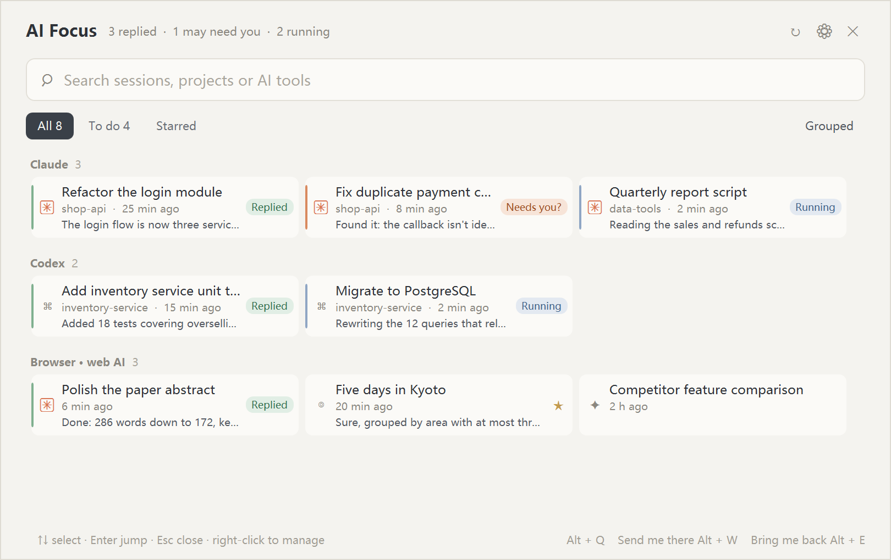
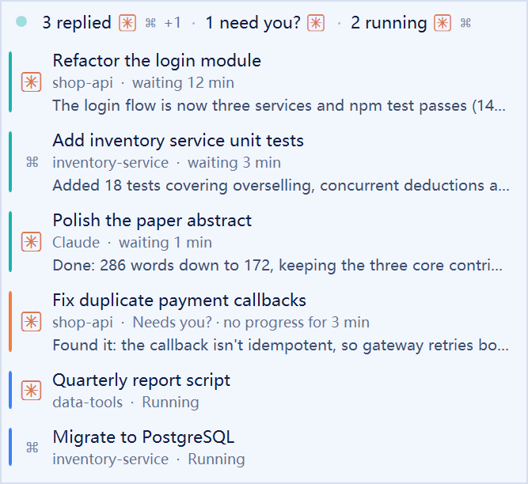

# AI Focus

English | [中文](README.md)

**One console for all the AIs scattered across your CLIs, desktop apps and browsers.**

AI Focus is a cross-app AI console: it finds these AI entry points and brings them into one panel, so you can see **who is running, who is waiting for you, for how long, and what they just did**, then takes you there in one keystroke. Windows only for now.

ChatGPT, Claude and Muse in the browser, several Claude Code tabs in Windows Terminal, the Codex desktop app… With that many windows it is hard to tell which AI has finished, which one is waiting for your approval, and which has been idle for half an hour.

It does not replace any AI tool and never proxies model requests. Everything is read locally: no network, no API keys.

<p align="center"></p>

## Features

**See at a glance who needs you**
- **Floating widget**: a small capsule on the edge of the screen, e.g. "● 2 replied [icons] · 1 running [icons]". Hover to list the sessions waiting for you, with how long they have waited and a one-line brief of the AI's last reply; click to go there. After 10 minutes of waiting the dot starts to breathe slowly; after 30 minutes it turns deeper.
- **Automatic states**: when a session stops running it becomes **Replied** and a Windows notification appears; clicking it takes you straight there. A Claude Code session sitting on an unfinished tool call is flagged **Needs you?** (usually a permission prompt); no progress for a few minutes is flagged **Stuck?**.

<p align="center"></p>

**Send me there, bring me back**
- **Alt + W — send me there**: jump to the session that has waited longest; press again for the next one, in the order they finished.
- **Alt + E — bring me back**: return to the window you were working in before; even after hopping between several AIs it returns to your original window.
- Jumps land on the exact **Windows Terminal tab** (background tabs included), the exact **Codex thread**, and the exact **browser tab**.

**Main panel (Alt + Q)**
- Cards show title, working directory, waiting time and the AI's last line; click to jump.
- Two layouts: **grouped by tool** or **mixed**. Sessions that need you come first; everything else keeps its place instead of reshuffling whenever you switch windows.
- Search, star, mark as to-do, rename, set project.

**Supported tools**
- **Claude Code**: every Windows Terminal tab and other terminals; working directory and last reply come from `~/.claude/projects`.
- **Codex**: the desktop app window, plus threads in `~/.codex` that are running or waiting for your reply (last 8 hours), opened directly at the right thread.
- **Web** (browser extension required): ChatGPT, Claude, Gemini, Perplexity, DeepSeek, Kimi, Doubao, Qwen, Yiyan, Yuanbao, Grok, Copilot, Muse and 40+ other sites. Generation detection is tuned for ChatGPT, Claude and Gemini.
- AI desktop apps and editors: ChatGPT, Claude, Cursor, Windsurf, Trae, VS Code and more.

**Also**: English / Chinese UI (follows Windows by default), start with Windows, real app icons and site favicons, every hotkey customisable.

## Install and run

Requires Windows 10 1809 or later (x64).

### Download a release

1. Install the [.NET Desktop Runtime 10](https://dotnet.microsoft.com/download/dotnet/10.0) (x64; 9 also works). If it is missing, a dialog points you to the download at startup.
2. Download the zip from [Releases](https://github.com/jy1989/AiFocus/releases), extract it and run `AiFocus.exe`.

The program is not code-signed, so Windows SmartScreen may show a warning.

### Build from source

Requires the [.NET 9 SDK](https://dotnet.microsoft.com/download) or newer:

```powershell
dotnet build AiFocus.sln -c Debug
.\src\AiFocus\bin\Debug\net9.0-windows10.0.17763.0\AiFocus.exe
```

Or double-click `启动 AI Focus.bat` in the repository root.

AI Focus lives in the system tray; press **Alt + Q** to open the panel, and right-click the tray icon for Settings or Exit.

### Optional: browser extension (web AIs)

AI Focus works without it, but then browsers are only recognised per window. With the extension you get every AI tab, generation state and favicons.

1. Start AI Focus.
2. Open `chrome://extensions` (Edge: `edge://extensions`), turn on Developer mode, click "Load unpacked" and pick the `extension` folder from the release package or repository.

That's it. The extension has a fixed ID, so AI Focus registers the browser bridge for Chrome and Edge by itself every time it starts (current user's registry only, no admin rights). After updating the extension, click "Reload" on it once.

## Hotkeys and actions

| Action | Default |
|---|---|
| Open / close the panel | `Alt + Q` |
| Send me there: the session waiting longest | `Alt + W` |
| Bring me back: your previous window | `Alt + E` |
| Close the panel | `Esc` or ✕ |

- The panel stays on top and does not close when you click outside it; it closes when you jump to a session.
- Click a card to jump.
- ☆ stars a card, ◷ marks it as to-do; right-click to rename or set a project.
- Hotkeys, start with Windows, notifications, the widget and the UI language are all under ⚙ in the panel or "Settings…" in the tray menu.

## How states are detected

| Source | Running / stopped | Directory, reply |
|---|---|---|
| Claude Code | Terminal title prefix: spinner = running, ✳ = idle | Session transcript in `~/.claude/projects`, matched by terminal title |
| Codex | `task_started` / `task_complete` events in the thread log | Same thread log |
| Web | The extension watches for the page's "Stop generating" button | Not read |

"Needs you?" and "Stuck?" are inferred — a long build can trigger them too, hence the question mark.

## Privacy

- No account, no external services; everything runs on your machine.
- What is read: window titles, the local Claude Code / Codex transcripts (for directory and brief), and — through the extension — titles, URLs and generation state of AI sites.
- The extension asks for `tabs`, `scripting`, `favicon` and access to all sites: its content script is injected into every page but only runs on the AI sites listed in `extension/sites.js`.
- Data lives in `%LOCALAPPDATA%\AiFocus\`: `settings.json` (settings), `sessions.json` (stars, to-dos, renames), the bridge registration `native-host.json` and the diagnostic `debug.log`.
- Exiting AI Focus never closes any AI window or tab.

## Project layout

- `src/AiFocus` — the WPF app: window discovery, state detection, panel, widget.
- `src/AiFocus.Bridge` — Native Messaging bridge for the browser (stdio ↔ named pipe).
- `extension` — Chrome / Edge extension (Manifest V3).
- `scripts` — build and run; `register-native-host.ps1` registers the bridge by hand (rarely needed: AI Focus does it at startup).
- `tests/AiFocus.Probe` — command-line probe (lists detected windows, Claude Code sessions…).
- `docs/images` — README screenshots, produced by demo mode: `AiFocus.exe --demo --view=list|widget --lang=zh|en`. Demo mode uses made-up sessions, reads no real windows or transcripts, registers no hotkeys, and can run next to a running AI Focus.

## Known limitations

- Web generation detection depends on page structure and may break when a site changes; sites without a dedicated reader (e.g. Muse) only get generic detection.
- The browser extension is loaded manually (not in a store), and the app is not code-signed.

## License

This project is licensed under the [MIT License](LICENSE).
