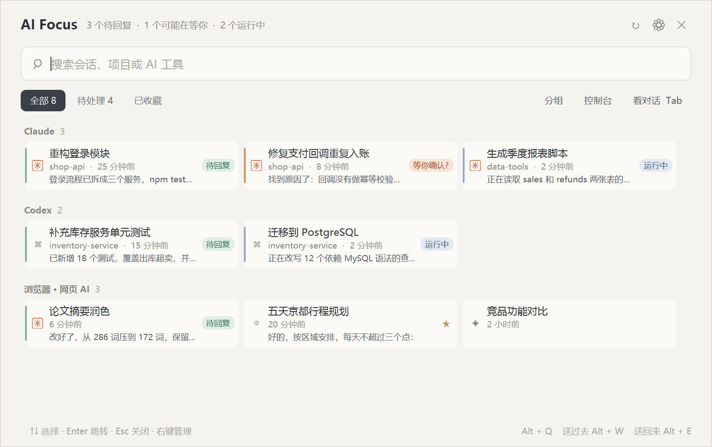
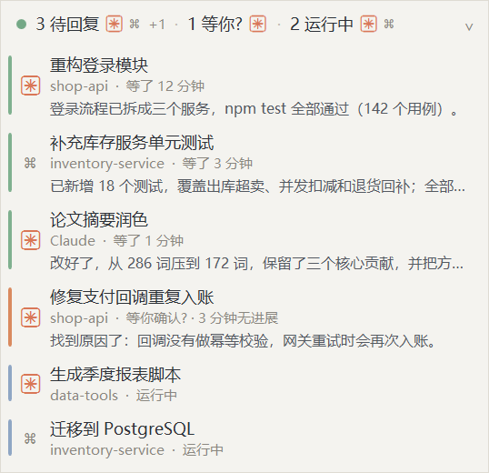

# AI Focus

[English](README.en.md) | 中文

**给同时开着很多 AI 的人用的专注力面板（Windows）。**

网页版 ChatGPT / Claude / Muse、好几个 Claude Code 终端标签、Codex 桌面版……窗口一多，就很难知道哪个 AI 跑完了、哪个在等你批准、哪个已经空等了半小时。AI Focus 把它们集中到一个地方：**谁在跑、谁在等你、等了多久、它做完了什么**，然后一键把你送过去。

它不替代任何 AI 工具，也不代理模型请求；所有数据都在本机读取，不联网，不需要 API Key。

<p align="center"></p>

## 功能

**一眼知道谁在等你**
- **悬浮窗**：屏幕边上一个小胶囊，例如「● 2 待回复 [图标] · 1 运行中 [图标]」。悬停展开等你的会话，带"等了 12 分钟"和 AI 最后回复的一句话简报，点一下直达。等待超过 10 分钟，状态点开始缓慢呼吸；超过 30 分钟颜色加深。
- **自动状态**：会话从"运行中"变成停下时自动标为 **待回复**，并弹出 Windows 通知，点击通知直接跳转。Claude Code 长时间停在一个还没结果的工具调用上，会标为 **等你确认?**（多半在等你批准权限）；几分钟没有任何进展，标为 **可能卡住**。

<p align="center"></p>

**一键送过去、送回来**
- **Alt + W 送过去**：直接跳到等你最久的会话，连按就按完成先后依次处理。
- **Alt + E 送回来**：回到你被送过去之前自己在用的窗口；在几个 AI 之间连续跳转后，也会回到最初那个工作窗口。
- 能精确定位到 **Windows Terminal 的具体标签页**（包括后台标签）、**Codex 的具体会话**、**浏览器的具体标签页**。

**主面板（Alt + Q）**
- 卡片显示标题、所在目录、等待时长和 AI 最后一句回复；单击直接跳过去。
- 两种排列：**按工具分组** 或 **混合**；需要你处理的排在最前，其余位置保持稳定，不会因为你切换窗口而乱跳。
- **看对话**（Tab）：右侧显示选中会话最近几轮对话，Markdown 排版，先看清上下文再决定要不要切过去。
- **控制台**：铺满屏幕，所有会话一屏显示。正在显示的窗口给出**实时画面**（和 Alt+Tab 预览同一机制），后台标签和最小化的窗口显示最近几条对话。
- 搜索、收藏、手动标记待处理、改名、设置项目。

**支持的工具**
- **Claude Code**：Windows Terminal 各标签页及其他终端；从 `~/.claude/projects` 读取工作目录、最后回复和对话。
- **Codex**：桌面版窗口，以及 `~/.codex` 里正在运行或等你回复的会话（8 小时内），可以直接打开到具体会话。
- **网页版**（需要浏览器扩展）：ChatGPT、Claude、Gemini、Perplexity、DeepSeek、Kimi、豆包、通义千问、文心一言、腾讯元宝、Grok、Copilot、Muse 等 40 多个站点；生成状态检测和对话读取目前适配 ChatGPT、Claude、Gemini。
- AI 桌面应用和编辑器：ChatGPT、Claude、Cursor、Windsurf、Trae、VS Code 等。

**其他**：中文 / English 界面（默认跟随系统）、开机自启、真实应用图标和网站 favicon、所有快捷键可自定义。

## 安装与运行

需要 Windows 10 1809 及以上、[.NET 9 SDK](https://dotnet.microsoft.com/download)。

```powershell
dotnet build AiFocus.sln -c Debug
.\src\AiFocus\bin\Debug\net9.0-windows10.0.17763.0\AiFocus.exe
```

也可以直接双击仓库根目录的 `启动 AI Focus.bat`。程序驻留在系统托盘，按 **Alt + Q** 打开面板；右键托盘图标可以打开设置或退出。

### 可选：浏览器扩展（网页版 AI）

不装扩展也能用，只是浏览器只能按窗口识别。装上之后能列出每个 AI 标签页、检测生成状态、读取对话、显示 favicon。

1. 先启动 AI Focus。
2. 打开 `chrome://extensions`（Edge 为 `edge://extensions`），开启"开发者模式"，点"加载已解压的扩展程序"，选择仓库里的 `extension` 目录。
3. 复制扩展详情页里的 32 位扩展 ID，在 PowerShell 中执行：

   ```powershell
   .\scripts\register-native-host.ps1 -Browser Chrome -ExtensionId <扩展ID>
   # Edge 用 -Browser Edge
   ```

4. 在扩展管理页对该扩展点"重新加载"。

注册脚本只写入当前用户的 Native Messaging 注册项，不需要管理员权限。扩展更新后需要在扩展管理页点一次"重新加载"。

## 快捷键与操作

| 操作 | 默认 |
|---|---|
| 打开 / 关闭面板 | `Alt + Q` |
| 送过去：跳到等你最久的会话 | `Alt + W` |
| 送回来：回到刚才自己的窗口 | `Alt + E` |
| 看对话 | 面板里按 `Tab` |
| 关闭面板 | `Esc`，或点 ✕ |

- 面板置顶显示，点面板外面不会关闭；跳到会话时会自动关闭。
- 单击卡片跳转；看对话模式下单击是选中预览，双击或 Enter 跳转。
- 卡片上的 ☆ 收藏、◷ 标记待处理；右键可以改名、设置项目。
- 快捷键、开机自启、通知、悬浮窗、界面语言都在面板右上角 ⚙ 或托盘"设置…"里修改。

## 状态是怎么判断的

| 来源 | 运行中 / 停下 | 目录、回复、对话 |
|---|---|---|
| Claude Code | 终端标题前缀：旋转符号 = 运行中，✳ = 空闲 | 按终端标题对应 `~/.claude/projects` 里的会话记录 |
| Codex | 会话记录里的 `task_started` / `task_complete` 事件 | 同一份会话记录 |
| 网页版 | 扩展检测页面上的"停止生成"按钮 | 扩展从页面读取 |

"等你确认?"和"可能卡住"是推断出来的：一个很长的构建命令也可能触发，所以文案带问号。

## 隐私

- 不需要账号，不连接任何外部服务，所有处理都在本机完成。
- 读取的内容：窗口标题、Claude Code / Codex 的本地会话记录（用来显示目录、简报和对话），以及扩展从 AI 网站页面读到的标题、网址、生成状态和对话。
- 浏览器扩展需要 `tabs`、`scripting`、`favicon` 和所有网站的访问权限：内容脚本会注入每个页面，但只在 AI 站点列表（`extension/sites.js`）中的网站上运行。
- 数据保存在 `%LOCALAPPDATA%\AiFocus\`：`settings.json`（设置）、`sessions.json`（收藏、待处理、改名），以及诊断日志 `debug.log`。
- 退出 AI Focus 不会关闭任何 AI 窗口或网页。

## 项目结构

- `src/AiFocus`：WPF 主程序：窗口发现、状态判断、面板、悬浮窗、控制台。
- `src/AiFocus.Bridge`：浏览器 Native Messaging 桥接（stdio ↔ 命名管道）。
- `extension`：Chrome / Edge 扩展（Manifest V3）。
- `scripts`：构建、运行、注册桥接。
- `tests/AiFocus.Probe`：命令行探测工具（列出识别到的窗口、Claude Code 会话、对话等）。
- `docs/images`：README 截图，由演示模式生成：`AiFocus.exe --demo --view=list|widget --lang=zh|en`。演示模式使用虚构的会话，不读取真实窗口和会话记录，不注册快捷键，可以和正在运行的 AI Focus 同时打开。

## 已知限制

- Windows Terminal 和浏览器的实时画面只能显示窗口当前的标签页；后台标签在控制台里显示最近对话。
- 网页版的生成状态和对话读取依赖页面结构，网站改版可能失效；Muse 等未专门适配的站点只做通用检测。
- 浏览器扩展需要手动加载，未上架商店；程序未做代码签名。
